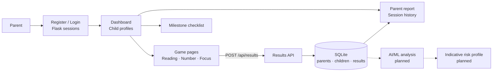

# 🌈 NeuroPlay

### A Unified Game-Based Platform for Preliminary Screening of Dyslexia, Dyscalculia and ADHD


[](LICENSE)

> An engaging, parent-facing platform where children (ages 5–10) play short games that capture accuracy, reaction time and error patterns, producing an **indicative** learning profile for further professional evaluation.

**Vidya Academy of Science and Technology, Thrissur** · Department of Computer Science and Engineering
Main Project · Group 14 · Guide: Asst. Prof. Thulasi Rajan K

> ⚠️ **BrightSteps is a screening prototype, not a diagnostic tool.** Displayed metrics are descriptive and are not clinical cut-offs. Concerns should be discussed with a qualified professional.

---

## 📌 Table of Contents

- [Overview](#-overview)
- [Key Features](#-key-features)
- [System Architecture](#-system-architecture)
- [Games](#-games)
- [User Roles](#-user-roles)
- [Use Cases](#-use-cases)
- [Tech Stack](#-tech-stack)
- [Data Model and Routes](#-data-model-and-routes)
- [Project Structure](#-project-structure)
- [Getting Started](#-getting-started)
- [Roadmap](#-roadmap)
- [Literature Background](#-literature-background)
- [Team](#-team)
- [License](#-license)

---

## 📖 Overview

ADHD, dyslexia and dyscalculia can affect attention, reading, memory, number sense and problem-solving, and early identification helps in providing support. Existing screening approaches usually assess one condition at a time, which makes it hard to get a unified view of a child's reading, numerical, attention, memory and behavioural abilities.

**BrightSteps** combines child-friendly games into a single Flask web platform. A parent registers, creates child profiles, launches the games, and reviews stored results and a per-child report. The longer-term goal is to apply AI/ML to gameplay and behavioural data such as:

- 🎯 Accuracy
- ⏱️ Reaction time
- ❌ Mistakes and missed targets
- 🤔 Hesitation
- 📈 Consistency and performance across levels

to generate an indicative risk profile and explore personalised support strategies, refined through consultation with qualified professionals.

**Current state:** the unified platform (accounts, child profiles, three playable games, result storage, parent report) is implemented. The AI/ML analysis layer is still in planning (see [Roadmap](#-roadmap)).

---

## ✨ Key Features

| Feature | Description | Status |
|---|---|---|
| **Parent accounts** | Registration and login; passwords stored as Werkzeug hashes; session-based access | Implemented |
| **Multiple child profiles** | Name, age (5–10), grade and language per child, scoped to the parent account | Implemented |
| **Unified dashboard** | One place to pick a child, launch games and see recent results | Implemented |
| **Game-based assessment** | Reading, number-sense and attention games with per-session metrics | Implemented (3 games) |
| **Unified result storage** | Score, accuracy, duration and a JSON payload of game-specific metrics in SQLite | Implemented |
| **Parent report** | Per-game average accuracy, session counts and full session history | Implemented |
| **Milestone checklist** | Pre-built developmental milestone checklist served from the same platform | Implemented |
| **AI/ML risk profile** | Analysis of gameplay data to generate an indicative risk profile | Planned |
| **Personalised support strategies** | Suggestions refined with qualified professionals | Planned |

---

## 🏗️ System Architecture



### Flow

1. A parent registers or logs in; the session stores `parent_id`.
2. The dashboard lists the parent's child profiles; the parent selects one.
3. A game page loads with the selected child's details. Game logic runs client-side in JavaScript.
4. On completion the game posts score, accuracy, duration and a metrics payload to `/api/results`.
5. The server validates the game key and child ownership, then writes the result to SQLite.
6. The dashboard and report aggregate results per game.

---

## 🎮 Games

Implemented in the current codebase:

| Game | Targets | Summary | Captured metrics |
|---|---|---|---|
| 🦊 **Reading Adventure** | Literacy / reading | 22 rounds across 11 domains: phonological awareness, phonological memory, rapid naming, letter–sound knowledge, word and pseudoword decoding, reading accuracy, reading fluency, spelling, vocabulary and comprehension, working memory. Includes audio prompts, hints and skip | Per-round domain, correctness and response time |
| 🏴‍☠️ **Treasure Number Race** | Number sense | 18 rounds of choosing the larger of two numbers, in three difficulty bands (values up to 5, 10, 20) | Score, accuracy, correct / total |
| 🎈 **Focus Balloon Pop** | Selective attention, inhibition, reaction time | 30-second round: pop only the target-colour balloons; 3 lives | Score, accuracy, correct, incorrect, missed, average reaction time (ms) |

Planned assessment games from the project plan:

| Condition | Game | Skill assessed |
|---|---|---|
| ADHD | Catch the Right One | Sustained attention |
| ADHD | Don't Tap! | Inhibition / impulsivity |
| ADHD | Remember the Path | Working memory |
| Dyslexia | Letter Hunter | Visual discrimination |
| Dyslexia | Word Detective | Reading / word recognition |
| Dyslexia | Sound & Rhythm | Phonological processing |
| Dyscalculia | Which Has More? | Number sense |
| Dyscalculia | Number Line | Number-line understanding |
| Dyscalculia | Number Pattern | Numerical pattern recognition |

---

## 👥 User Roles

| Role | Responsibilities |
|---|---|
| **Parent** | Register and log in, manage child profiles (ages 5–10), launch games with a child, open the milestone checklist, view dashboard results and the parent report |

---

## 🎯 Use Cases

- Register and log in as a parent
- Add a child profile (name, age 5–10, grade, language)
- Play a game with a selected child
- Store game results automatically on completion
- View recent results on the dashboard
- View a per-child report with per-game accuracy and session history
- Open the developmental milestone checklist
- *(Planned)* View an AI-generated indicative risk profile

---

## 🧰 Tech Stack

**Current implementation**

| Layer | Technology |
|---|---|
| Language | Python, HTML, CSS, JavaScript |
| Web framework | Flask (`>=3.0,<4`) with Jinja2 templates |
| Security helpers | Werkzeug (`>=3.0,<4`) password hashing |
| Database | SQLite (`data/platform.db`, created automatically on first run) |
| Frontend | Server-rendered templates with vanilla JS game logic |
| Audio prompts | Browser Speech Synthesis API (Reading Adventure) |
| Milestone checklist | Pre-built static single-page app served by Flask |

**Planned (from project specification)**

| Layer | Technology |
|---|---|
| AI/ML | RAG, LLM, ML classification of gameplay data |
| Vector database | FAISS / ChromaDB |
| Database | MySQL / PostgreSQL |
| Web framework | Flask / FastAPI |
| Tooling | VS Code |

---

## 🗄️ Data Model and Routes

### Tables

| Table | Key columns |
|---|---|
| `parents` | `id`, `name`, `email` (unique), `password_hash`, `created_at` |
| `children` | `id`, `parent_id`, `name`, `age`, `grade`, `language`, `created_at` |
| `results` | `id` (UUID), `parent_id`, `child_id`, `game_key`, `score`, `accuracy`, `duration_ms`, `payload_json`, `created_at` |

`children` and `results` cascade on parent deletion.

### Routes

| Route | Method | Auth | Purpose |
|---|---|---|---|
| `/` | GET | – | Landing page (redirects to dashboard if logged in) |
| `/register` | GET, POST | – | Create a parent account (password ≥ 6 characters) |
| `/login` | GET, POST | – | Log in |
| `/logout` | GET | – | Clear session |
| `/dashboard` | GET | ✔ | Child profiles, game launcher, recent results |
| `/children/add` | POST | ✔ | Add a child profile (age 5–10) |
| `/game/<game_key>/<child_id>` | GET | ✔ | Launch `reading`, `number` or `focus` |
| `/api/results` | POST | ✔ | Save a game result (JSON) |
| `/report/<child_id>` | GET | ✔ | Per-child report and session history |
| `/milestone` | GET | ✔ | Milestone checklist app |

---

## 📁 Project Structure

```
unified_learning_platform/
├── app.py                 # Flask app: auth, profiles, games, results, report
├── requirements.txt       # Flask, Werkzeug
├── data/                  # SQLite database (created at runtime)
├── templates/             # base, landing, login, register, dashboard,
│                          # game_reading, game_number, game_focus, report
├── static/
│   ├── css/platform.css   # Shared styles
│   ├── js/                # reading.js, number.js, focus.js (game logic)
│   ├── games/             # Per-game asset folders
│   ├── milestone_app/     # Pre-built milestone checklist app
│   └── milestone/         # Original milestone archive (git-ignored)
└── README.md
```

---

## 🚀 Getting Started

> ⚠️ The project is under active development.

### Prerequisites

- Python 3 `[minimum Python version]`
- `pip`
- A modern browser (Chrome recommended)

### Installation

```bash
# 1. Clone the repository
git clone https://github.com/Nasri3112/BrightSteps_unified_platform_milestone_fixed.git
cd BrightSteps_unified_platform_milestone_fixed/unified_learning_platform

# 2. Create and activate a virtual environment (Windows Command Prompt)
python -m venv venv
venv\Scripts\activate

#    macOS / Linux equivalent
# python3 -m venv venv
# source venv/bin/activate

# 3. Install dependencies
pip install -r requirements.txt

# 4. Run the app
python app.py
```

Then open `http://127.0.0.1:5000` in your browser.

### Configuration

| Variable | Purpose | Default |
|---|---|---|
| `SECRET_KEY` | Flask session signing key | `change-this-secret-key-in-production` |

Set a strong `SECRET_KEY` before any non-local deployment. `[Production deployment instructions]`

### Running tests

`[Test command]`

---

## 🗺️ Roadmap

- [x] Literature review (AI/ML, game-based assessment, ADHD, dyslexia, dyscalculia)
- [x] Problem identification and objectives
- [x] Assessment game planning
- [x] Unified Flask platform: accounts, child profiles, dashboard, result storage, parent report
- [x] Reading, number-sense and focus games
- [ ] Define assessment parameters (accuracy, response time, errors, hesitation, consistency)
- [ ] Remaining planned games (memory / working-memory and the other ADHD, dyslexia and dyscalculia games)
- [ ] AI/ML analysis of gameplay data
- [ ] Indicative risk profile and personalised support strategies
- [ ] Testing and validation
- [ ] Final project presentation

---

## 📚 Literature Background

| Paper | Focus | Key Finding |
|---|---|---|
| Classifying ADHD Presentations Using Temporally Segmented Behavioral Data from a Serious Game (Kim et al., 2026) | ADHD classification from serious-game data | Random Forest performed best at 81.82% accuracy; limited to ADHD and a small clinical sample |
| Screening Capabilities for the 3D Dyscalculia Identification Game Framework (Pudjoatmodjo et al., 2025) | Serious-game dyscalculia screening | Makes screening interactive with teacher-facing reports; still relies on predefined indicators |
| A Machine Learning-Based Classification Model to Support University Students with Dyslexia with Personalized Tools and Strategies (Zingoni et al., 2024) | Personalised support recommendations | Over 90% prediction accuracy in a real-case evaluation; depends on self-reported questionnaires |
| Let AI Read First: Enhancing Reading Abilities for Individuals with Dyslexia through Artificial Intelligence (Zhao et al., 2025) | AI-assisted reading (LARF) | Improved comprehension and retrieval over Bionic Reading in a 150-participant study |
| Unobtrusive Monitoring of Learners' Game Interactions to Identify Their Dyslexia Level (Al-Sarem et al., 2020) | Implicit dyslexia identification from gameplay | 70% identification accuracy with 26 children; small sample and rule-based modelling |

**Gap addressed:** existing work targets a single condition, relies on predefined indicators or self-reported data, or uses small samples. BrightSteps aims at a unified, behaviour-driven screening platform across all three conditions.

---

## 👨‍💻 Team

**Group 14 · Department of Computer Science and Engineering**

| Name |
|---|
| Fathima Nasrin P |
| Hidha Nazarin |
| Midhun N M |
| Mohamed Anas |

**Project Guide:** Asst. Prof. Thulasi Rajan K
**Institution:** Vidya Academy of Science and Technology, Thrissur

---

## 📄 License

This project is licensed under the [MIT License](LICENSE).
---

<p align="center">Made by Group 14, Vidya Academy of Science and Technology</p>
